# User Guide

Phidler is a graphical layout tool for photonic integrated circuits, built on
[gdsfactory](https://gdsfactory.github.io/gdsfactory/) and its generic PDK. You
place real photonic components, wire them together with real routed waveguides,
check the result, and export a foundry-ready GDS. No code required, though
Python is always a keystroke away (and if you'd rather not touch either, you can
just ask Claude; see [Ask Claude to build it](#ask-claude-to-build-it)).

This page is the **reference**: every panel and every tool, in depth. If you'd
rather learn by building something concrete, the [MZI tutorial](tutorial.md)
walks the whole flow end to end on a real device.

## The design process, end to end

A photonic layout comes together in roughly this order. Each phase feeds the
next, so it helps to see the whole arc before diving into the details:

1. **Pick a platform** ([Project Settings](#project-settings)). The material
   system (silicon, silicon nitride, lithium niobate/tantalate) sets the
   core/cladding indices and thickness that drive the suggested waveguide width,
   the propagation-time readouts, and the FDTD stack. Choose this first: it is
   the physical context everything else is interpreted in (and it is reopenable
   anytime).
2. **Place components** ([Placing components](#placing-components)). Drop the
   building blocks of your circuit (splitters, bends, rings, grating couplers)
   from the palette. Phidler exposes ~300 components from the generic PDK,
   grouped by function. This is choosing *what* sits on the chip.
3. **Set each component's parameters** ([Editing parameters](#editing-parameters)).
   Dial in lengths, widths, radii, gaps, and the **cross-section** each part
   uses. The cross-section is the most consequential choice. It decides the
   waveguide's width and which [layers](#layers) the geometry lands on, and it is
   what lets a component connect cleanly to the rest of your circuit.
4. **Connect them with routes** ([Routing](#routing)). Click port-to-port and
   Phidler lays down a real waveguide with low-loss Euler bends, optionally
   length-matched to a target delay. This is where a set of parts becomes a
   circuit.
5. **Verify**. Two independent checks: [DRC](#design-rule-checking-drc) for
   geometric rules (minimum width/spacing), and [FDTD simulation](#fdtd-simulation)
   for the physics. First a sub-second
   [vertical mode solve](#checking-your-cladding-is-thick-enough) to confirm the
   waveguide guides a single, well-confined mode, then full 3D propagation to
   watch light move through the device. The mode solve's effective index feeds
   back into the propagation-time readouts, so verifying and designing inform
   each other.
6. **Export** ([Saving, loading, and exporting](#saving-loading-and-exporting)).
   A `.phidler` project to keep editing, a `.gds` for the foundry, or a
   gdsfactory `.py` script for code review and version control.

In practice you won't go straight down the list. You'll route, hit a
spacing violation, widen a gap, re-route, re-simulate. The point is that the
tools are arranged around that loop. The rest of this guide covers each phase in
turn.

## Project Settings

On startup (and via File > New), Phidler shows a Project Settings dialog:

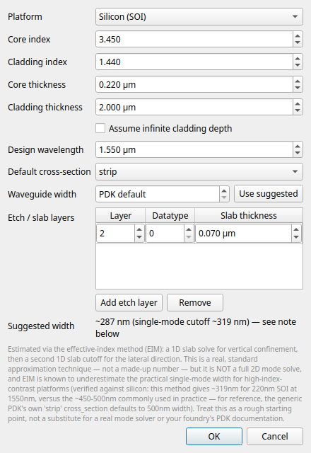

- **Platform**: pick Silicon (SOI), Silicon Nitride, Lithium Niobate (LN),
  Lithium Tantalate (LT), or Custom to set the core/cladding refractive
  indices and core thickness. LN/LT use real published thin-film-on-
  insulator index values (cross-checked against literature; see
  [Development](development.md#key-design-notes) for sourcing), not a
  full multi-layer stack-up model. There's no LN/LT-specific
  cross_section in the generic PDK either, so these presets affect the
  suggested-width estimate and project metadata, same as the other
  platforms, not the actual GDS layers.
- **Design wavelength**: used together with the platform to estimate a
  suggested single-mode waveguide width.
- **Cladding thickness**: a generic default (2µm), not tied to any
  specific foundry process or platform. Switching platforms doesn't
  change this field, since it's a wafer/process choice rather than a
  material property. It doesn't affect the suggested-width estimate (which
  assumes a semi-infinite cladding) but is the real vertical extent used
  by FDTD Simulation's mode solver and propagation runs; see
  [FDTD simulation](#fdtd-simulation) for why this number actually
  matters there.
- **Default cross-section**: which gdsfactory cross-section new routes use
  by default.
- **Waveguide width**: one width for the whole project. Every route in the
  default cross-section, and every component built in it, is drawn at this
  width, and changing it redraws what is already placed. The width is snapped
  to an even number of nanometres, which a centred waveguide needs on the 1 nm
  layout grid; a width that cannot be drawn is refused and nothing changes.
  Leave it at
  **PDK default** to use the PDK's own width (0.5 µm for strip). **Use
  suggested** copies the suggested width below into it. The same control is on
  the routing toolbar as **Width**. What it does not change:
    - components in another cross-section (nitride, metal, …);
    - a component whose own `width` you set to something else;
    - composite parts (several `mzi` and heater variants) that gdsfactory can
      only build at the PDK width, and parts that fix their own widths (tapers,
      some crossings). They stay as the PDK draws them and the status bar names
      them.

  The change is not on the undo stack; set the width back to reverse it.
- **Etch / slab layers**: for rib waveguides, list the partial-etch layers
  (e.g. SLAB150 on layer 2) and the **slab thickness** each leaves behind: the
  core height *remaining* after the etch, less than the full core thickness
  above. FDTD Simulation then models a ridge-over-slab rib instead of a fully
  etched strip (see [FDTD simulation](#fdtd-simulation)). Leave it empty for a
  plain strip waveguide. Add a row with **Add etch layer**; a row left at 0 µm
  is ignored.

The suggested width is an estimate from the effective-index method, not a
full 2D mode solve. Read the note in the dialog before treating it as
exact. It's a starting point, not a substitute for your foundry's PDK
documentation.

You can reopen this dialog anytime via **File > Project Settings…**
without clearing your current design.

## Placing components

Use the **Components** panel on the left:

- Type in the filter box to search by name.
- Core photonics categories (waveguides, bends, couplers, MMIs, rings,
  MZIs, grating couplers, filters, spirals, tapers, edge couplers,
  detectors) are expanded by default. Everything else (MEMS, quantum,
  microfluidics, analog, test structures, etc.) is under **Other**.
- Hover over a component to preview its actual geometry before placing it.
- Click a component (or select it and press Enter) to arm placement, then
  click on the canvas to place it.

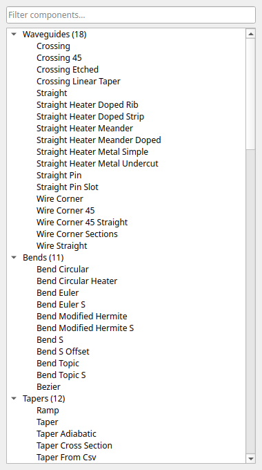 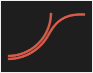

### The component catalog

Phidler exposes the placeable parts of the generic PDK, roughly 300 components
that build cleanly on their own. (Parts that need required arguments, or that
are not real standalone cells, are filtered out so everything in the palette
actually places.) They are grouped by function; the core photonic categories are
expanded by default, and each one answers a recurring need in a circuit:

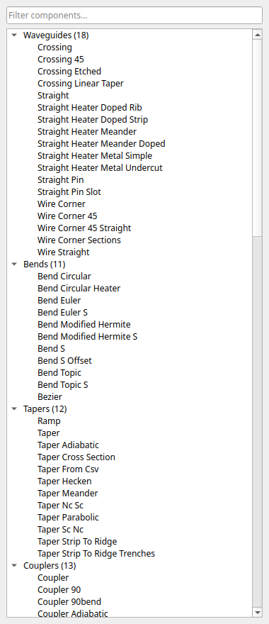

- **Waveguides**: the straight sections (and crossings) light travels along.
  `straight` is the workhorse; `crossing` lets two waveguides cross with low
  crosstalk; `straight_heater_metal_simple` carries a heater on top for
  thermo-optic tuning, and `straight_pin` embeds a PIN junction for modulation.
- **Bends** turn a waveguide. `bend_euler` is the default low-loss *adiabatic*
  bend (curvature ramps up gradually rather than snapping to a fixed radius);
  `bend_circular` is a constant-radius turn; `bend_s` and `bezier` offset a
  waveguide sideways.
- **Tapers** smoothly change a waveguide's width or cross-section. `taper` is
  linear; `taper_adiabatic` and `taper_parabolic` are lower-loss profiles;
  `taper_sc_nc` / `taper_nc_sc` convert between silicon and nitride waveguides.
- **Couplers** split or combine light by *evanescent* coupling between two
  closely-spaced waveguides. `coupler` is a directional coupler; `coupler_ring`
  couples a bus into a ring; `coupler_adiabatic` and `coupler_broadband` split
  flatly across wavelength.
- **Edge couplers** get light on and off the chip at a cleaved facet:
  `edge_coupler_silicon`, or `edge_coupler_array` for a whole fiber array.
- **MMIs** are multimode-interference splitters, the compact, broadband,
  fabrication-tolerant workhorse for splitting and combining: `mmi1x2` (1→2),
  `mmi2x2` (2→2), plus `_with_sbend` variants that fan the ports apart.
- **Rings** are resonators for filtering, modulation, and sensing: `ring_single`,
  `ring_double`, `ring_single_pn` (a modulator), `ring_double_heater` (tunable),
  and `disk` (a whispering-gallery disk resonator).
- **MZIs** are ready-made Mach–Zehnder interferometers (the [tutorial](tutorial.md)
  builds one by hand from MMIs and routes): `mzi`, and `mzi_lattice` for a
  cascade with a sharper filter response.
- **Grating couplers** couple light *vertically* to a fiber above the chip via
  a diffraction grating: `grating_coupler_elliptical_te`,
  `grating_coupler_rectangular`, `grating_coupler_array`.
- **Filters** are wavelength- and polarization-selective parts: `dbr` (a Bragg
  reflector), `awg` (an arrayed-waveguide-grating (de)multiplexer),
  `polarization_splitter_rotator`, and `terminator` (dumps unwanted light
  without reflecting it).
- **Spirals** coil a long waveguide into a small footprint, for delay lines or
  on-chip propagation-loss measurement: `spiral`, `delay_snake`,
  `spiral_racetrack_heater_metal`.
- **Detectors**: `ge_detector_straight_si_contacts`, a germanium photodetector
  that converts guided light into photocurrent.

Everything else (MEMS, quantum/superconducting parts, microfluidics, analog RF,
pads, vias, dies, text, and process-control test structures) lives under
**Other**. Use the filter box to search across all of them by name (it matches
both the raw gdsfactory name and the prettified display label).

### Custom components

**File > Import Custom Components…** loads a Python file and adds any
`@gf.cell`-decorated functions it defines (with no required arguments) to
the palette under **Custom**. The file is remembered with the project, so
reopening a saved project that uses a custom part re-imports it
automatically.

## Editing on the canvas

- **Select**: click an item. Rubber-band drag to select multiple, or
  **Edit > Select All** (`Ctrl+A`). The rubber band works like KiCad: drag
  **left → right** to select only items the box *fully encloses* (a *window*
  select), or **right → left** to also grab anything the box merely *touches* (a
  *crossing* select). The status bar names the mode as you drag. To reach an item
  buried under others, **Alt+click** cycles down through the stack, or right-click
  and pick it from **Select under cursor**.
- **Move**: drag a selected item. Dragging a port close to another
  instance's port snaps them into exact alignment; otherwise the move
  snaps to the grid. Snapping is applied live as you drag, not just on drop.
- **Rotate / Flip**: `R` rotates 90°; `H` and `V` flip the selection
  horizontally / vertically (about either screen axis). You can also use the
  on-canvas transform overlay (see below).
- **Delete / Copy / Paste**: `Delete`, `Ctrl+C`, `Ctrl+V`.
- **Duplicate**: `Ctrl+D` (also in the Edit and right-click menus) places a copy
  of each selected component two grid steps down and to the right of it, with the
  same parameters, rotation, flip, scale and array. The copies become the
  selection, so pressing `Ctrl+D` again steps out a row. It is one undo step.
  Routes are not copied.
- **Cancel with `Esc`**: backs out of whatever you're in the middle of:
  an armed placement, the measure, source or probe tool, or a route. `Esc` works no
  matter which panel has focus (you don't have to click the canvas first).
  Routing is two-stage: the first `Esc` drops a half-finished route (the start
  port you picked), and a second `Esc` exits routing mode.
- **Undo / Redo**: `Ctrl+Z` / `Ctrl+Shift+Z`.
- **Pan**: middle-mouse-drag. **Zoom**: scroll wheel, or View > Zoom to
  Fit / Zoom to Selection (`Ctrl+0` / `Ctrl+Shift+0`).
- **Right-click** the canvas for a context menu of common actions.
- Grid pitch and snap-to-grid are adjustable from the toolbar.

### Aligning and distributing multiple instances

Select 2 or more instances, then use **Edit > Align** (or the same submenu
in the right-click context menu):

- Align Left/Right/Top/Bottom Edges, or Align Horizontal/Vertical Centers.
- Distribute Horizontally/Vertically: needs 3+ instances; spaces their
  centers evenly along that axis, keeping the two extreme instances fixed.

Each is a single undo step, even when it moves several instances.

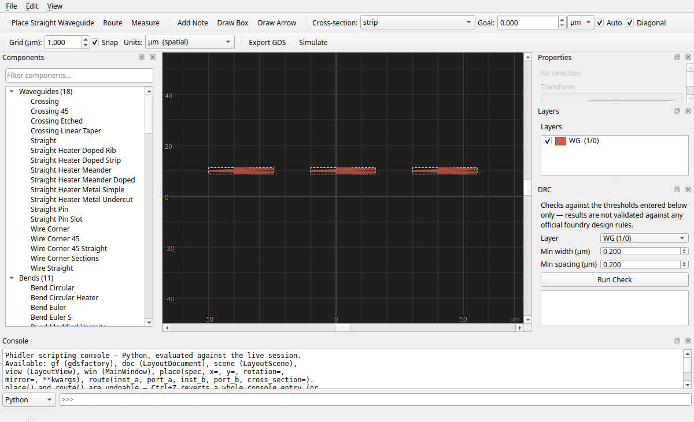

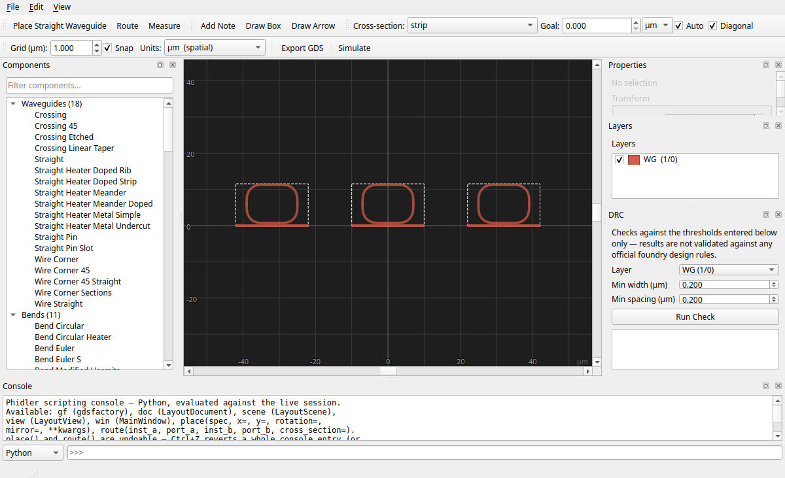

### Transform handles

Selecting a single instance shows a **rotate handle** on the canvas, and a
shape also gets **corner handles** for resizing:

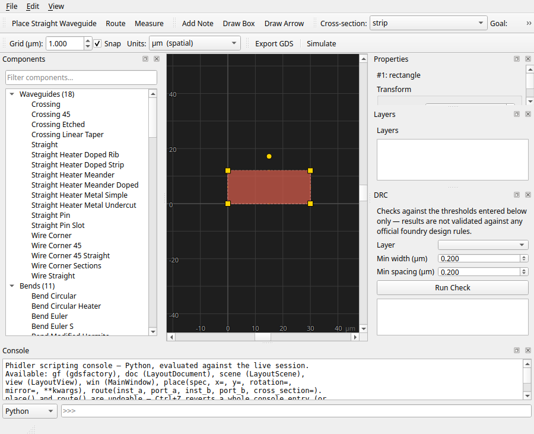

- **Drag the handle above the shape** to rotate freely around the instance's
  position. It previews live and commits to the undo stack on release.
- For a quick 90° rotation, a flip, or resetting rotation/mirror/scale back to
  defaults, use `R` / `H` / `V` or the right-click context menu.
- **Drag a corner of a shape to resize it.** Rectangles, ellipses, circles and
  the other entries in the palette's **Shapes** group also show a square handle
  on each corner. Dragging one resizes the shape while the opposite corner stays
  where it is; a dashed outline shows the new extent, and the shape is rebuilt
  when you release, as one undo step. Hold **Shift** to keep the proportions.
  New sizes snap to the grid when **Snap** is on.
    - A rectangle or ellipse stretches in each direction on its own, by changing
      its `size` / `radii` parameter, so the result is a real shape of that size
      and the Properties panel shows the new numbers.
    - A circle changes its `radius`, so it scales evenly.
    - Shapes with no such parameter (a triangle, a star) scale evenly through the
      instance's **Scale**.
- **Photonic components have no corner handles**, so a stray drag can't distort
  a device. Set their scale numerically in the Properties panel's **Scale**
  field (below). Scale is a real geometric magnification of the shape and ports,
  not a component parameter like length.

## Editing parameters

Select an instance and use the **Properties** panel (right side) to edit
its parameters: length, width, radius, cross-section, etc. Click **Apply**
to regenerate its geometry. `cross_section` is a dropdown of the active
platform's valid names, so you can't type something invalid.

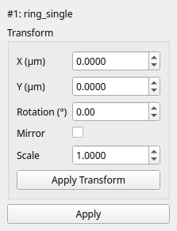

### What the parameters are, and how they edit

Phidler reads the component's actual function signature, so the fields you see
are exactly the parameters that part accepts. They differ from component to
component. Every parameter that has a default is shown, and how it edits depends
on its type:

- **Numbers** (lengths, widths, counts, radii) are numeric fields.
- **Booleans** are checkboxes.
- **`cross_section`** is a **dropdown** constrained to the active PDK's valid
  names, so you cannot type one that will not build.
- Other **text** parameters are free-text fields. A few take the *name* of a
  sub-component (e.g. `bend="bend_euler"`); these are editable, but most designs
  leave them at the default.
- A parameter whose default is a complex object (a function, a list) is shown
  greyed-out with its value and marked *"not editable from the panel yet"*.
  Adjust those by exporting to a script or from the console instead.

Click **Apply** to rebuild the instance's geometry from the new values (undoable
like any edit). The parameters you will meet most often, across many components:

| Parameter | What it controls |
|---|---|
| `cross_section` | The waveguide profile — width and layers — the part is drawn with. The most consequential parameter; see below. |
| `length` | Length of a straight section, taper, or heater (µm). |
| `width` | Waveguide or feature width (µm). Widening raises confinement and shifts the effective index. |
| `radius` | Bend radius (µm). Smaller is more compact but lossier, down to a minimum the cross-section enforces. |
| `gap` | Edge-to-edge spacing (µm) between two coupled waveguides (couplers, rings) — the single biggest lever on how strongly they exchange light. |
| `length_x` / `length_y` | The footprint of a two-dimensional part — an MZI's arm length, a ring's straight sections. |
| `npoints` | How many points discretize a curve: higher is smoother but heavier geometry. |
| `taper_length` | The length a width/cross-section transition happens over; longer is more adiabatic (lower loss). |
| `spacing` / `pitch` | Center-to-center spacing in arrayed parts (grating-coupler arrays, edge-coupler arrays). |

### Cross-sections

A **cross-section** is the recipe for a waveguide's transverse profile: its
width, and which [layers](#layers) it occupies. It is both a component parameter
(`cross_section`) and the choice in the routing toolbar, so a route and the
components it joins can share one and line up. The generic PDK's main
cross-sections:

| Cross-section | What it is |
|---|---|
| `strip` | The default silicon wire — full-etch `WG` core, ~500 nm wide. Highest confinement; the standard for dense routing. |
| `rib` / `rib2` | A ridge over a partial-etch slab (`WG` + `SLAB`). Lower loss and the basis for doped/active devices, at the cost of weaker lateral confinement. Tell the simulator about the slab so it models the rib correctly — see [Rib waveguides](#rib-waveguides-etch-slab-layers). |
| `nitride` | A silicon-nitride (`WGN`) waveguide — lower index contrast means lower loss and broader bandwidth; used for visible light and low-loss interconnect. |
| `slot` | Two rails separated by a narrow gap that concentrates the field *in* the slot — for sensing and electro-optic/nonlinear fills. |
| `pn` / `pin` | A waveguide with a PN or PIN junction across it (adds doping layers) — the basis of carrier-depletion / injection modulators. |
| `strip_heater_metal` / `rib_heater_doped` | A waveguide with a heater on top (metal) or doped into the slab, for thermo-optic phase tuning. |
| `metal1` / `metal2` / `metal3` / `metal_routing` | Not optical — electrical routing on the metal layers, for the contacts and pads active devices need. |

Because the cross-section decides which layers geometry lands on, your choice
here is what populates the [Layers](#layers) panel: picking `rib`, a `pn`, or a
heater cross-section is exactly what makes the slab, doping, and metal layers
appear.

### Precision transform entry

The same panel has a **Transform** section above the parameter form:
X, Y, Rotation, Mirror, and Scale as typed numeric fields, for exact
placement instead of dragging by eye (matching a known coordinate from a
foundry PDK, for instance). Edit the values and click **Apply Transform**
to commit. It's undoable the same way a canvas drag is. The fields track
the selected instance's live transform automatically; editing one pauses
that tracking until you click elsewhere, so your typing isn't overwritten.

## Layers

Every shape in a GDS layout lives on a **layer**, a `(layer number, datatype)`
pair that tells the foundry which fabrication step draws it: which etch, which
implant, which metal. A photonic component is rarely a single layer; a modulator,
for instance, carries a waveguide core, doping implants, contacts, and metal all
at once.

The **Layers** panel (right side) lists every layer your design *actually* uses.
It starts empty and grows as you place, route, and import. A layer appears the
moment some component puts geometry on it, named from the active PDK (`WG`,
`SLAB150`, `M1`, …). Toggle a layer's visibility or change its color with the
checkbox and swatch; hover a layer for a one-line note on what it is for (the
same descriptions collected below).

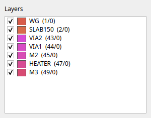

Layers appear because **components carry them**, not because you draw on them
directly. Phidler routes optical waveguides; it has no electrical-net router, so
the doping, metal, and heater layers below show up when you place a part that
already includes them (a heater-tuned ring, a PN modulator, a detector) or pick a
[cross-section](#cross-sections) that uses them, not from wiring them yourself.

### Layer types in the generic PDK

The generic PDK models a fairly complete silicon-photonics process. Grouped by
what they do, these are the layers you are likely to encounter:

**Silicon waveguide and etch**: the layers that define where light is guided.

| Layer | What it is |
|---|---|
| `WG` | Silicon waveguide core — full etch (~220 nm on standard SOI). Defines single-mode wire waveguides and grating teeth. |
| `SLAB150` | Half-etch silicon slab (~150 nm etch, leaving ~70 nm slab). Used under grating couplers and rib waveguides to improve coupling efficiency and confinement. |
| `SLAB90` | Shallow-etch slab (~90 nm). For very-low-loss rib waveguides, where a thicker slab reduces scattering. |
| `SHALLOW_ETCH` / `DEEP_ETCH` | Process masks for the shallow (~90 nm) and full-depth (~220 nm) silicon etch steps. |
| `DEEPTRENCH` | Deep isolation trench etched through the whole device layer to isolate regions optically and electrically. |
| `UNDERCUT` | Removes buried oxide beneath the silicon to form suspended membranes — MEMS, or ultra-low-loss waveguides. |
| `WGCLAD` | Waveguide cladding (typically SiO₂) surrounding the core. |

The half-etch slab layers are exactly what [FDTD's rib-waveguide
support](#rib-waveguides-etch-slab-layers) needs to know about to simulate a rib
correctly rather than as a fully-etched strip.

**Doping implants** define PN/PIN junctions for modulators and the
low-resistance contacts that feed them.

| Layer | What it is |
|---|---|
| `N` / `P` | Moderate n-type / p-type silicon doping — the junction of a PN-junction phase shifter or PIN modulator. |
| `NP` / `PP` | N+ / P+ implants — higher doping next to the waveguide to reduce series resistance. |
| `NPP` / `PPP` | N++ / P++ implants — heavy doping for low-resistance ohmic contact to metal vias. |

**Germanium**: for detectors and electro-absorption modulators.

| Layer | What it is |
|---|---|
| `GE` | Germanium grown selectively on silicon; absorbs near-IR (1.3–1.6 µm) for photodetectors and EA modulators. |
| `GEN` / `GEP` | N-doped / P-doped germanium — the cathode and anode contact regions of a Ge photodetector. |

**Silicon nitride**: a lower-contrast, lower-loss guiding layer.

| Layer | What it is |
|---|---|
| `WGN` | Silicon-nitride (Si₃N₄) waveguide core — lower index contrast than silicon gives lower loss and broader bandwidth; used for visible-light and low-loss interconnect PICs. |
| `WGN_CLAD` | Silicon-nitride waveguide cladding. |

**Metals, vias, and heaters**: electrical contact, routing, and thermo-optic
tuning.

| Layer | What it is |
|---|---|
| `VIAC` | Contact via — metal plug from M1 down to silicon or germanium. |
| `VIA1` / `VIA2` | Vias connecting M1→M2 and M2→M3. |
| `M1` / `M2` / `M3` | Metal routing layers 1–3; M3 is typically bond pads and RF lines. |
| `HEATER` | Resistive metal heater over a waveguide for thermo-optic phase shifting (silicon's index drifts ~1.8×10⁻⁴ /K). |
| `PADOPEN` | Pad opening — removes passivation over a bond pad for wire bonding or probing. |

**Process and utility**: non-optical layers the foundry and tooling need.

| Layer | What it is |
|---|---|
| `FLOORPLAN` | Chip floorplan boundary — the die extent. |
| `DICING` | Dicing lane, kept clear of devices so the wafer saw can cleave safely. |
| `DEVREC` | Device-recognition bounding box — the exclusion zone around a cell for placement and DRC. |
| `NO_TILE_SI` | Inhibits dummy-silicon fill in a region. |
| `PADDING` | Extra clearance around a device. |
| `TEXT` / `LABEL_INSTANCE` / `LABEL_SETTINGS` | Human-readable labels and stored metadata — not physical structures. |

**Ports and simulation markers**: annotations, not fabricated geometry.

| Layer | What it is |
|---|---|
| `PORT` / `PORTE` / `PORTH` | Optical / electrical / horizontal port markers — where a cell connects to its neighbors or the outside world. |
| `TE` / `TM` | TE- and TM-polarization port markers (TE — in-plane E-field — is the standard for SOI strip waveguides). |
| `SOURCE` / `MONITOR` | FDTD source and monitor markers — where a simulation injects power or records fields. |
| `DRC_MARKER` | Highlights a design-rule violation; not a physical layer. |

You will rarely see all of these at once; only the layers your particular
components and cross-sections use ever appear in the panel.

## Routing

1. Click **Route** in the toolbar (or press the shortcut shown in the
   tooltip).
2. Pick a cross-section from the toolbar dropdown.
3. Click a port on one component, then a port on another. A route is
   drawn between them: straight sections joined by euler bends
   (continuously-varying curvature, the standard low-loss "adiabatic"
   turn in photonics), not constant-radius circular bends.
4. Routes are selectable and deletable like any other item, and fully
   undoable.

**Diagonal** routing (on by default in the toolbar) sends a route along the
short diagonal path with all-angle euler bends, instead of a manhattan
L/U-turn. Untick it for manhattan-only routes. (Diagonal is ignored when a
length goal is set; those use the manhattan meander.)

**Length matching**: set a **Target** length in the toolbar before routing (as a
distance in µm or a delay in fs/ns), and with **Auto** on Phidler folds an
adiabatic meander into the route to hit it. That's the matched delay a balanced
interferometer or a true-time-delay line needs, without hand-drawing the wiggle.
Already placed a route and want it longer or shorter? Select it, and the
**Properties** panel shows a **Route** editor: type a new target, click **Apply
Length**, and the meander re-runs to match (undoable, like any edit). Set the
target to 0 to drop the goal and route straight again.

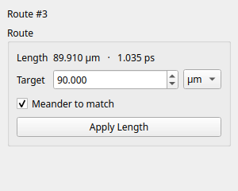

**Component avoidance**: when a component sits on the straight path between the
two ports, the route automatically detours around it rather than crossing
through it. This is best-effort: a single detour around the obstacles in the
way; if it can't cleanly clear everything (several components boxing the route
in, or one right at a port), it falls back to a direct route rather than
weaving through. gdsfactory has no general obstacle router, so think of it as
"gets out of the way of the obvious blocker", not guaranteed avoidance on a
dense layout.

## Measuring distances

1. Click **Measure** in the toolbar.
2. Click a first point, then a second. A dashed line and label appear
   showing the distance, dx, and dy between them (also shown in the
   status bar). Clicking near a port snaps to its exact center, the
   same way routing's port clicks do.
3. Click again to start a new measurement (clears the old one), or press
   `Esc` to cancel a pending first point and exit Measure mode.

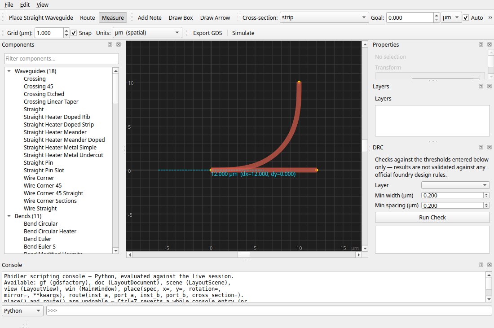

Turning on Measure mode turns off Route mode and cancels any armed
placement, and vice versa; only one click-driven mode is active at a
time.

## Reference GDS backdrop

**File > Import Reference GDS…** loads an existing layout (e.g. a foundry
floorplan) to design against. It's shown dimmed and is **not** included
in your own GDS export. It's purely a visual aid. **File > Clear
Reference** removes it. The reference path is remembered with the saved
project.

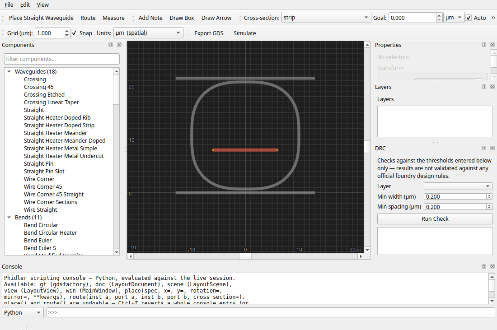

## Design rule checking (DRC)

The **DRC** panel (right side) runs a width/spacing check against
thresholds you enter yourself:

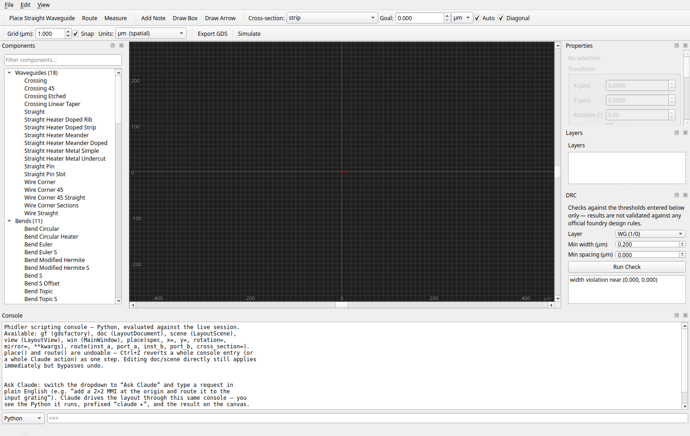

1. Pick a layer.
2. Enter a minimum width and/or minimum spacing in microns.
3. Click **Run Check**.
4. Double-click a violation in the results list to jump the canvas to it.

This checks against the numbers you typed in, not against any official
foundry rule deck; the generic PDK this app uses doesn't ship one.

## Saving, loading, and exporting

| Action | Menu | Produces |
|---|---|---|
| Save your editable project | File > Save / Save As | `.phidler` (JSON) |
| Reopen a project | File > Open | accepts `.phidler` or `.py` |
| Export final GDS | File > Export GDS | `.gds` |
| Export as Python code | File > Export Python Script… | `.py` |

**`.phidler`** is the full-fidelity project format: instances, routes,
layer colors, the reference backdrop path, and project settings all
round-trip exactly.

**Unsaved changes** are tracked the way most apps do it: the title bar shows the
file name with a modified marker (a leading `*`, or the standard edited dot on
macOS) whenever there's something unsaved, and it clears the moment you save.
Closing the window — or starting a New project or Opening another — with unsaved
changes prompts you to **Save**, **Discard**, or **Cancel** first, so you can't
lose work by reflex.

**Exported `.py` scripts** recreate your design with direct gdsfactory
calls (`gf.get_component(...)`, `add_ref`, `route_single`). They're useful for
keeping a design as reviewable, version-controlled code. Running the
script directly (`python my_design.py`) writes a `.gds` named after the
script next to it.

**Opening a `.py` script** (File > Open) reads the actual code back into
Phidler, including hand-edits. If you change `length=10.0` to
`length=25.0` directly in the script and reopen it, Phidler picks up your
edit. This is additive to `.phidler`, not a replacement: layer colors and
the reference backdrop don't have a representation in the script format
and reset to defaults when you open one. Restructuring the generated code
(loops, helper functions, heavily renamed variables) isn't supported and
will raise a clear error rather than silently guessing wrong.

## Scripting console

The **Console** dock (bottom, toggle from the View menu) is a Python REPL
running against your live session:

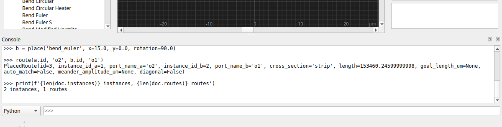

Available names:

| Name | What it is |
|---|---|
| `gf` | the `gdsfactory` module |
| `doc` | the current `LayoutDocument` |
| `scene` | the current `LayoutScene` |
| `view` | the current `LayoutView` |
| `win` | the main window |
| `place(spec, x=, y=, rotation=, mirror=, **kwargs)` | places a component immediately |
| `route(inst_a, port_a, inst_b, port_b, cross_section=)` | routes between two ports immediately |

Multi-line blocks (`for`, `if`, `def`, ...) work like a normal REPL: keep
typing until you enter a blank line. Up/Down arrows recall history.

`place()` and `route()` are **undoable**: a single Ctrl+Z reverts a whole
console entry (a one-liner, or a `for`-loop that placed twenty things) as one
step, the same as any toolbar edit. Reaching into `doc`/`scene` directly still
applies immediately but bypasses undo — that's the power-user escape hatch.

## Ask Claude to build it

The scripting console is for when you'd rather type code than click. This is for
when you'd rather just say what you want. Flip the dropdown at the bottom of the
**Console** dock from **Python** to **Ask Claude**, type a request in plain
English — say, "add a 2×2 MMI at the origin and route both of its outputs to the
grating couplers on the right" — and Claude lays it out on the canvas while you
watch.

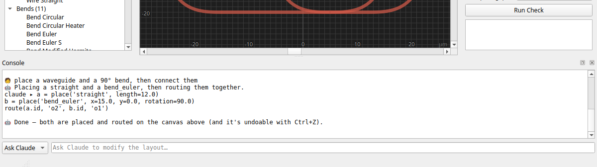

It's optional. The mode only shows up when two pieces are in place: the `ai`
extra (`pip install -e ".[ai]"`) and the [Claude Code](https://claude.com/code)
command-line tool (`claude`) on your PATH. If either is missing, the dropdown
never appears and the Console stays an ordinary Python console.

Here's the part worth understanding: Claude doesn't get a separate back door into
your design. It drives the very same `place()` / `route()` / `doc` session the
console already gives you. So every edit it makes shows up right there in the
console, tagged `claude ▸`, and on the canvas — exactly as if you'd typed it
yourself. Nothing happens that you can't see scroll past.

A few things that make it feel less like talking to a black box:

- **It knows what you've selected.** Select two components and say "route these
  together," or select one and say "make this 3 µm longer" — Claude checks your
  canvas selection before it does anything, so "this" and "these" mean what
  you'd expect.
- **You can ask, not just tell.** "What's placed right now?" or "which ports
  does instance 4 have?" work fine; it reads the live document to answer.
- **It stays in its lane.** The bridge Claude talks to runs inside the app, on
  localhost only, and it's handed nothing but Phidler's own tools — placing,
  routing, running code in the console. It can't reach files on your disk or run
  shell commands through this.

Its edits are **undoable**, and grouped: one Ctrl+Z reverts everything a single
Claude message did (all the components it placed and routes it drew), so you can
let it draft freely and back the whole thing out in one step if it's not what you
wanted.

## FDTD simulation

The **Simulate** button in the toolbar opens a separate window that runs a
real local FDTD solve against your actual placed layout, using `photonfdtd`,
a separate, optional dependency not published on PyPI. If it's not
installed, you'll see a message explaining what to install instead of a
crash. The window has two tabs: a fast **Vertical Mode Profile** solver,
and full **Propagation (FDTD)** with movie playback.

### Checking your cladding is thick enough

Before running a full simulation, the **Vertical Mode Profile** tab is
worth a quick check. It solves the guided mode for your waveguide's
cross-section in well under a second:

1. Enter the **Core width**, **Wavelength**, and (optionally) more than
   one mode to solve for.
2. Click **Solve**. The plot shows the mode's intensity confined within
   the core (outlined in cyan over the field), decaying into the cladding
   above and below.
3. The status line reports the effective index and whether the mode is
   **well confined** or whether the **cladding may be too thin**. If
   your cladding (set in **File > Project Settings…**) isn't thick
   enough, the mode gets visibly squashed against the edge of the plot
   instead of decaying naturally. That's your answer to "is my cladding
   thickness enough" without needing a full propagation run.

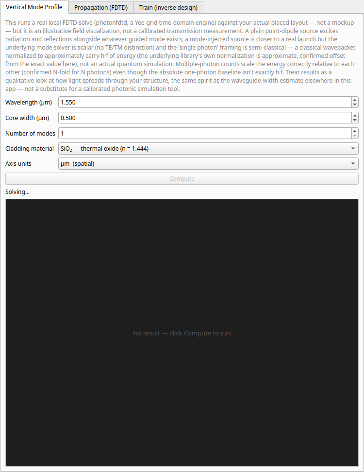

### Placing sources and running a simulation

The **Propagation (FDTD)** tab runs a true 3D time-domain simulation and
plays the result back as a movie:

1. Click **Place Source on Canvas**, then click anywhere on the main
   canvas (clicking near a port snaps to its exact position, the same
   as the measure tool). Each click adds a row to the source table and a
   marker on the canvas.
2. Set the source's color either as **Wavelength (µm)** or **Energy
   (eV)**. Editing either column updates the other automatically, so
   you can specify "a photon at 0.8 eV" directly instead of converting
   it to a wavelength by hand.
3. In the table, pick each source's **Kind**:
   - **dipole**: a plain oscillating point source. Always available,
     simplest option, not mode-matched to anything.
   - **single_photon**: launches a wavepacket built from the real
     guided mode at that position (needs **Core width** filled in),
     normalized to carry approximately one photon's worth of energy.
     **Photon count** scales the energy up from there.
   - **scripted**: type a Python expression of `t` (time, in seconds)
     into the **Script** column, e.g.
     `np.sin(2*np.pi*1.93e14*t) * np.exp(-((t-3e-15)/1e-15)**2)`
     (`np` is available). Evaluated with the same trust model as the
     scripting console elsewhere in this app: full Python, not a
     restricted sandbox, since this is already a single-user desktop
     tool. Wavelength/Energy/Photon count/Core width are ignored for
     this kind.
   - **cherenkov**: models a charged particle punching *up through the
     chip* (perpendicular to the layout plane, out of the top-down view)
     faster than light's local phase velocity. It is laid down as a track
     of point dipoles along the z axis, each fired with a delay equal to
     the particle's transit time to that point (distance / βc), whose
     superposition forms the Cherenkov shock cone, seen top-down as a
     ring spreading from the impact point. Set the particle speed
     **β = v/c** and the **tilt from vertical** in the source row
     (Cherenkov radiation requires β·n > 1, i.e. faster than the medium's
     phase velocity).
4. Set **Cell size** and **Run time**, then click **Run Simulation**. If
   the estimated run time is more than a few seconds, you'll be asked to
   confirm first. True 3D propagation is genuinely more expensive than
   a quick preview, and this estimate is calibrated against real
   measured runs, not guessed. Run time goes up to 100 ps on the slider
   (1 ns if you type it into the box) for watching light propagate over a
   long distance; however long the run, the movie is kept to a few hundred
   frames so it stays playable.
5. Once it finishes, use the **Play** button and the slider underneath
   to scrub through the field evolving over time, overlaid on a cyan
   outline of your actual chip layout, looping back to the start
   automatically. **Speed** sets the playback rate (0.25×–4×), and
   **Save GIF…** writes the whole animation (field plus chip outline, exactly
   as shown) to an animated GIF at the current speed.

While a run is in flight, a progress bar under the **Compute** button tracks
it: a busy indicator during start-up (the kernel compile locally, or
connect-and-upload for a remote run), then a 0–100 % fill as the solve steps
through time. The same bar drives local, GPU, and remote runs.

### Measuring intensity at a point

Sources tell you what goes *in*; **measurement probes** tell you what comes
*out* at a particular spot — how much light actually reaches the far arm of a
splitter, or how much survives a bend.

1. Click **Place Measurement Probe on Canvas**, then click the point you want
   to measure. Clicking near a **waveguide joint** — any component or route
   port — snaps the probe to that joint exactly, the same snapping the source
   and measure tools use, so you can land on a connection point without
   pixel-hunting for it. Click well away from a joint and the probe stays
   exactly where you put it, which is what you want for a mid-span reading.
   Probes are green diamonds on the canvas, to tell them apart from the round
   orange source markers.
2. Each click adds a row to the probe table reporting field intensity |Ez|²
   at that point: **I (this frame)** follows the playback slider as the movie
   plays, while **⟨I⟩ (run mean)** and **I (peak)** summarise the whole run.
   The numbers are in the field's own arbitrary units — comparing probes with
   each other is meaningful, reading one as an absolute power is not.
3. Probes are pure post-processing over the field movie the run already
   records, so they cost nothing to move and **never require a re-run**. Drop
   a probe after a simulation has finished and it fills in immediately; type
   new X/Y values into its row and it re-samples the same result at the new
   point.

A probe placed outside the simulated grid reads **off grid** rather than
zero — most often a probe left over from a whole-layout run when you've since
switched on *Simulate selected components only*.

#### Live probe graphs

Each probe row has a **Graph** tick (on by default). While it's ticked, that
probe's intensity-vs-time trace is drawn in the top-right of the field view in
the probe's own colour, with a dashed playhead marking the frame on screen — so
the graph animates in step with the field as you play or scrub.

The graphs can be exported two ways:

- **As part of the sim canvas**: they're painted into the field view itself, so
  **Save GIF…** writes them into the animation alongside the field and chip
  outline, playhead sweeping as the movie runs.
- **Separately**: **Export Graphs…** writes either a PNG of the graphs on their
  own (no field behind them) or a CSV of time in femtoseconds plus one
  intensity column per probe, for plotting elsewhere.

The **Graphs** row under the probe table sets what is drawn. Every control
redraws from the recorded run, so nothing needs re-running:

- **Quantity**: **Intensity |Ez|²** or **Field Ez** against time; **Energy
  passed**, the running total of intensity, whose final values compare two
  probes (the arms of a splitter, say) directly; or **Spectrum**, the field's
  power against wavelength from 0.6 to 1.6 times the run wavelength. A long
  run keeps fewer movie frames, and if they are too far apart to resolve the
  light's oscillation the spectrum reads "no data" rather than show an alias.
- **Log (dB)**: plot in dB below the peak, down to −40 dB, so a weak signal
  next to a strong one stays visible. It does not apply to Field Ez.
- **Same scale**: give every probe the same vertical range so heights compare.
- **Overlaid**: draw all probes in one plot instead of one each.
- **Size**: small, medium or large.

The exports follow these settings: the PNG is drawn the same way, and the CSV
holds the chosen quantity (with wavelength in µm as its first column for a
spectrum). The settings are saved with the project.

If the window is too short to stack every graph, the overlay says how many it
had to hide; **Export Graphs…** always includes all of them.

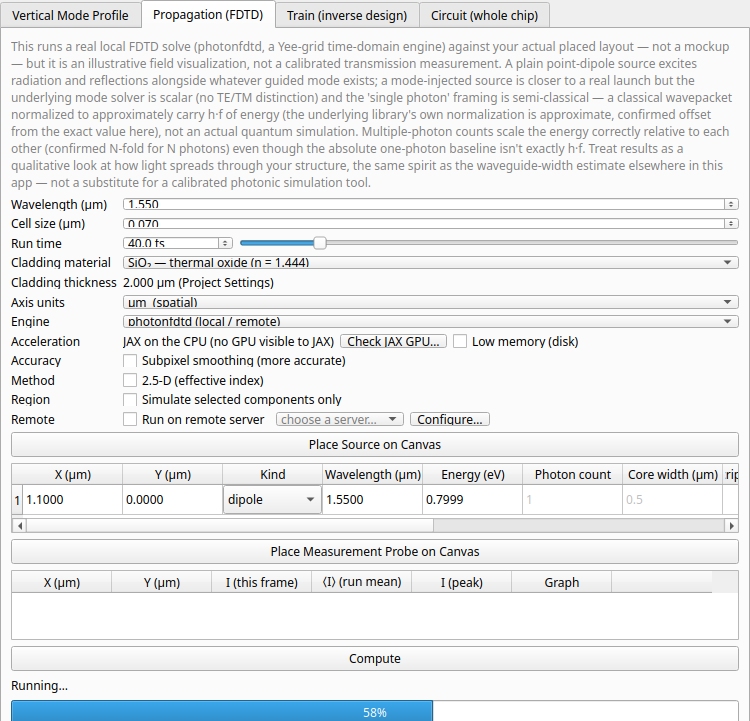

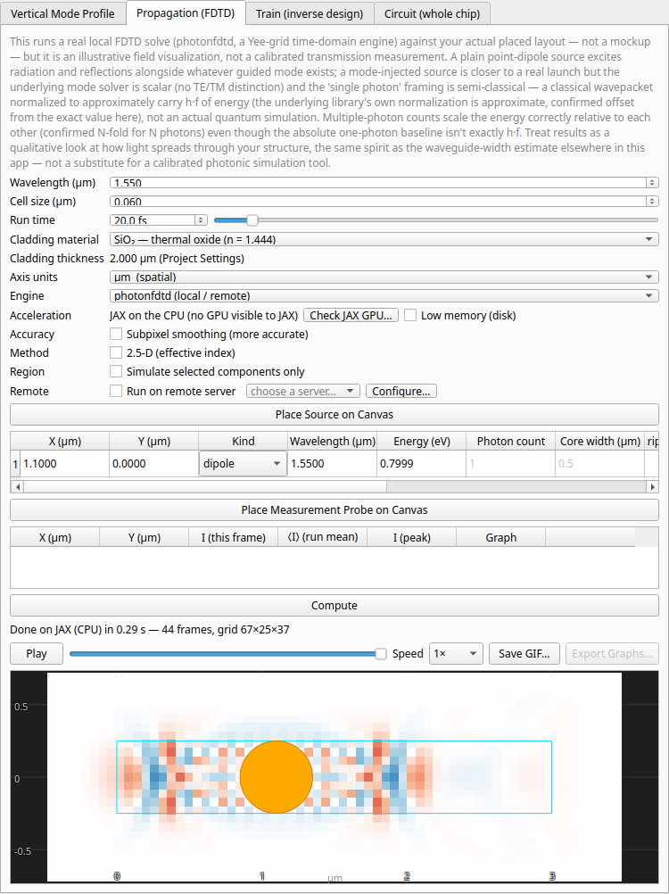

#### Speed

photonfdtd runs every simulation on **JAX** (XLA): on your **GPU** when JAX can
see one, otherwise on the CPU. There's nothing to choose. The **Acceleration**
row says where runs will go (**JAX on the GPU** or **JAX on the CPU**), and the
status line after a run names the device that actually ran (**"Done on JAX
(GPU)…"**), so a run that quietly fell back to the CPU is visible.

- **Getting the GPU.** Install JAX's CUDA build into the environment Phidler
  runs in: `pip install "jax[cuda12]"` for an NVIDIA GPU with a CUDA 12 (or
  newer) driver. The Flatpak bundles it; the AppImage runs on the CPU.
- **Check JAX GPU.** The button next to the device label starts JAX in a fresh
  process and reports what it found: the jax and CUDA-plugin versions, the
  devices JAX sees, your NVIDIA driver, and a test computation on the GPU. If
  JAX is on the CPU it says why: no NVIDIA GPU, the CUDA build not installed, a
  driver too old for CUDA 12, or the plugin installed but failing to load its
  CUDA libraries, in which case it shows what JAX logged. That last case is
  the one to watch for, because JAX only logs a warning and carries on, many
  times slower, on the CPU.
- **First runs compile.** The first run of a given grid size traces and
  compiles the stepper, so it's slower; later runs of the same size reuse it.
- **Low memory (disk)** keeps the fields in scratch files and streams the grid
  through the CPU or GPU a slab at a time, so peak memory stays bounded by one
  slab and a grid too big for memory still runs, more slowly. photonfdtd also
  falls back to this by itself, with a warning, when a run plainly won't fit.
- The propagation domain keeps only as much **cladding** as the mode's
  evanescent field actually needs (a few decay lengths, scaled by your
  platform's index contrast), rather than the full cladding the mode solver
  uses. That's a thinner z-stack and a much smaller, faster run, with no change
  to the top-down field you see. (Runs are also single-precision by default.)
- The recorded **field movie** keeps only the one component and the one
  horizontal plane (mid-core, z=0) the playback actually shows, not the whole 3D
  volume, typically ~90× less memory. The plane shown is mid-core height, where
  the guided mode is strongest.

#### A sharper run: subpixel smoothing

The **Subpixel smoothing** checkbox (the **Accuracy** row) turns on photonfdtd's
anisotropic subpixel smoothing. Normally every grid cell is wholly one material
or the other, so a slanted or curved edge comes out as a staircase. With
smoothing on, cells that straddle an edge get a blended, direction-aware
permittivity instead — the boundary lands where it actually is, not on the
nearest cell wall. In practice that means a given cell size resolves your
geometry more faithfully, which is often a cheaper way to clean up a result than
shrinking the cell size everywhere. It costs a little setup time before the run.

#### A much bigger run: 2.5-D (effective index)

Every option above makes the same simulation go faster. The **2.5-D (effective
index)** checkbox (the **Method** row) instead makes it a *smaller* simulation,
which is usually the larger win by far.

A photonic layer is a thin core etched into an in-plane pattern. Rather than
resolving that vertical stack cell by cell, 2.5-D solves the stack's guided mode
once and collapses it into an **effective index**: the region under a waveguide
gets one index, the etched surround another, and a rib layer's remaining slab
its own in between. What's left is your chip *plan view* as a 2-D problem. The
vertical axis goes from a full core-plus-cladding stack to a single cell, so the
cell count drops by that whole factor — on the default Silicon platform, around
20× on a small device and far more on a real circuit. That's the difference
between simulating a region of your layout and simulating the layout.

It composes with everything else, so 2.5-D on the GPU is the fastest
configuration available.

The catch is that it's an approximation: it assumes the vertical mode profile
separates from the in-plane confinement. That holds very well for routing —
bends, directional couplers, MZIs, interferometers, anything that guides light
around the plane — and poorly for strongly three-dimensional behaviour, like an
out-of-plane grating coupler or a deep sub-wavelength gap. Two consequences
worth knowing:

- **Cladding thickness has no effect** on a 2.5-D run. The reduction has already
  consumed the stack, so that setting goes back to being inert on this path.
- **Cherenkov sources aren't available**, because a Cherenkov source *is* a track
  through the vertical stack — there's nothing left for it to cross. Phidler
  says so rather than quietly producing something. A **single photon** source
  does work: it matches the *lateral* mode of the reduced index map instead of
  the vertical cross-section.

Use 2.5-D to see how light moves through a circuit, then confirm anything
strongly 3-D with a full run over a smaller region.

#### Running out of memory on a big layout

The *solve* itself (the field arrays it steps in time) scales with the number of
grid cells (about 100 bytes per cell), and on one machine that's the only thing
that determines peak memory, so the whole-chip grid is what runs you out of
memory. Two things help:

- The **"Large simulation" dialog** now estimates the run before it starts: the
  grid's predicted **memory** (the number that OOMs) and the run **time** on each
  backend (Numba / GPU / plain NumPy). Read it. It tells you if a run won't fit.
- **Simulate selected components only** (the *Region* checkbox): select the
  device(s) you care about on the canvas, and the FDTD domain shrinks to just
  their bounding box (plus your sources). On a sprawling layout that's the
  difference between tens of GB and a couple; gigabytes → fits. It grids whole
  components, so it never cuts a device in half, but light leaving the region is
  absorbed at the edge, so use it for a **local** look at a device, not a
  through-circuit measurement. The memory/time estimate reflects the smaller
  region too.

If even a region is too big, a coarser **cell size** is the other lever (fewer
cells in every dimension), at some cost in accuracy.

#### Running on a remote server

If this machine is slow, low on memory, or has no GPU, you can offload a run to
another machine over SSH (a workstation or a GPU box) and get the field movie
back, while the UI here stays responsive. Tick **Run on remote server** and click
**Configure…**. Setup is a single step:

1. Choose your **SSH host**. The list holds the `Host` entries from your
   `~/.ssh/config` (files it pulls in with `Include` are read too; wildcard
   patterns such as `Host *` are left out). You can also type a host that isn't
   listed. That's the only required field. Phidler shells out to
   `ssh`/`scp`/`rsync` and lets your SSH config and agent/keys handle
   authentication; it stores no passwords (key-based, non-interactive auth is
   required).
2. Pick the remote **Acceleration**, or leave it on **Auto**. Auto inspects the
   remote's GPU during setup: on an NVIDIA box whose driver supports CUDA 12 it
   installs JAX's CUDA build so runs go to the GPU, and otherwise runs stay on
   the CPU. It then remembers what it chose. You can also pin **CPU (JAX)** or
   **GPU (JAX on CUDA 12)**. Either way it's the *remote's* hardware that
   matters, not this machine's.
3. Click **Connect && set up**. That one button tests the connection, installs
   phidler + photonfdtd on the remote if they aren't there yet (a one-time step,
   streamed into the log), detects the remote's hardware and installs the ideal
   accelerator, verifies, and saves. Click it again any time; it only reinstalls
   when needed (or when you tick **Force reinstall**, e.g. after updating a
   package).

The install location is derived for you (a managed venv under `~/phidler-remote`);
open **Advanced** only if you want to install into a specific directory or an
existing interpreter. After setup, ticking **Run on remote server** sends each
run to that host and brings the result back automatically. The progress bar fills
from the remote solve just as it does locally, and the result reports the device
(GPU or CPU) the remote actually ran on, so a request the remote couldn't honour is visible.

To use more than one machine, pick the server from the list beside **Run on
remote server**: it shows the same `~/.ssh/config` hosts. Each host keeps its own
acceleration and install settings, so switching back to one restores them. A host
needs **Connect && set up** once before its first run.

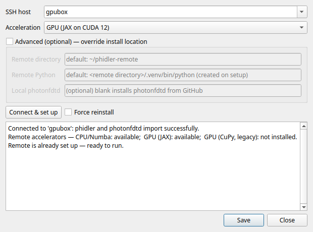

The remote must be a POSIX host (Linux/macOS) reachable by key-based SSH.
Projects that place **custom components** (local `.py` files) can't be offloaded
(those files don't exist on the remote), and that case is reported as a clear
error rather than failing mid-run.

#### Training a design (the Train tab)

The third tab of the simulation window, **Train (inverse design)**, fits a box
of your layout to a task the way a neural network is fitted to data: you mark a
design box and the input/output ports, pick a task (the built-in priority
encoder, your own dataset, or a target transfer matrix), and the etch pattern
inside the box is optimized by gradient descent. The result goes back on the
layout as an ordinary component. See the
[priority-encoder tutorial](training.md) for a complete walkthrough.

#### Running on Tidy3D (the cloud solver)

The **Engine** dropdown at the top of the run controls picks *which* FDTD solver
runs the propagation. The default is **photonfdtd** (everything above — local, the
acceleration options, or SSH). Switch it to **Tidy3D (cloud)** to run the same
layout on [Flexcompute's Tidy3D](https://www.flexcompute.com/tidy3d/) instead: a
different engine, not just a different machine. Phidler builds a `tidy3d.Simulation`
from your placed geometry — the same core/cladding, waveguides, and source
positions — submits it to Tidy3D's cloud, and plays the returned field movie back
in the same window.

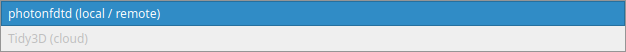

It's a separate, optional install and needs an account: `pip install
"phidler[tidy3d]"`, then configure your API key once with `tidy3d configure` (or
set `TIDY3D_API_KEY`). Until both are in place the **Tidy3D** option is greyed out
with a tooltip that says which piece is missing. A run **consumes FlexCredits**
from your Flexcompute account, so phidler asks you to confirm before submitting.
The Acceleration / Remote / Accuracy options don't apply on this engine (they're
photonfdtd's), so they grey out when Tidy3D is selected; **Cell size**, **Run
time**, **Region**, and your **sources** all still apply. This first version
supports **dipole** sources (the default); mode-matched / scripted / Cherenkov
sources aren't wired to Tidy3D yet.

**Read the disclaimer in the window.** Both tabs run a real solve against
your geometry, not a mockup. But treat the results as a qualitative
look at how light spreads through your structure, not a calibrated
transmission measurement or an actual quantum simulation, the same
spirit as the waveguide-width estimate in Project Settings. The mode
solver is scalar (no TE/TM distinction), and "photon count" scales
energy correctly *relative* to itself, but the absolute one-photon
baseline isn't exactly h·f; see the window's own disclaimer text for
specifics.

The material stack (core/cladding index, core thickness, **and now
cladding thickness**) comes from your current Project Settings platform.
Switching between Silicon, SiN, LN, or LT there changes what gets
simulated here too.

#### Rib waveguides (etch / slab layers)

By default the simulation treats the waveguide layer (1, 0) as a full-height
strip and everything else as cladding. If your design uses a **partial-etch
slab** (a rib waveguide, where a layer like SLAB150 (2, 0) leaves a thinner
slab of core material beside the full-height ridge), list that layer under
**Etch / slab layers** in Project Settings with its slab thickness. Both the
propagation run and the vertical mode solver then model the ridge-over-slab
cross-section: core material up to the slab height in the slab region, full
core height under the ridge. Without it, a rib is simulated as if it were fully
etched (no slab), which changes the mode and the confinement. A configured
layer that isn't actually drawn in the layout is skipped (it won't silently
map the wrong geometry).
