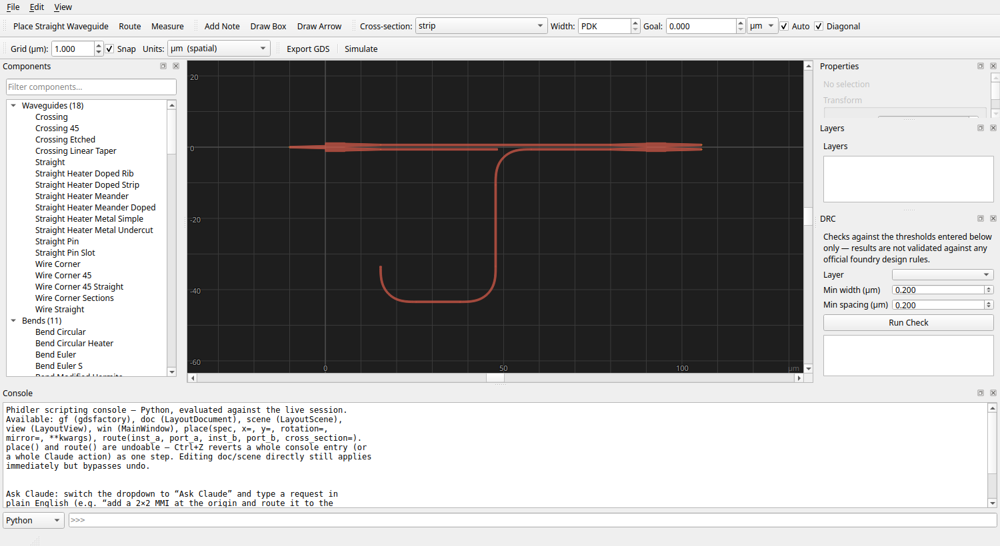

Phidler is a desktop app for laying out photonic integrated circuits. It puts
an interactive canvas in front of [gdsfactory](https://gdsfactory.github.io/gdsfactory/)'s
component library, so you can draw a circuit with the mouse instead of
writing and re-running a script.

<figure class="phi-shot" markdown>

</figure>

## What you can do with it

### Place and route by hand

Drag parts from a searchable palette and draw waveguides between ports. Set a
target length and Phidler adds a meander to hit it, for delay matching in an
interferometer or a delay line.

### See the light go through

The built-in [FDTD simulator](guide.md#fdtd-simulation) solves the guided mode
and animates a pulse through your actual layout. Run it locally, on an NVIDIA
or AMD GPU, or on a remote machine.

### Simulate a whole chip

Lithium niobate switches, heaters and photodetectors carry circuit models.
Drive pads with voltages and read detector currents across the chip in the
[Circuit tab](chip_simulation.md).

### Check and export

Run design rule checks against widths and spacings you set, then export a
real GDSII file, or a Python script that rebuilds the layout in gdsfactory.

### Script it when you want to

A live Python console runs against the open layout. With the
[Claude Code](https://claude.com/code) CLI installed, you can also describe a
circuit in plain English and watch it get placed and routed.

### Keep your parts

Save a part or a selection as a component file, with its layout, pins and
solved model together, and load folders of them as palette
[libraries](chip_simulation.md#component-files).

## Where to start

- [Install Phidler](install.md): AppImage, Flatpak, .deb and .rpm for Linux,
  or from source on Linux, macOS and Windows.
- [Feature tour](tour.md): a screenshot walk through the whole app.
- [Designing an MZI](tutorial.md): build a Mach–Zehnder interferometer with
  routing, length matching, a mode solve, DRC and export, in about fifteen
  minutes.
- [User guide](guide.md): the full reference.
- [Keyboard shortcuts](shortcuts.md) and [FAQ](faq.md).
