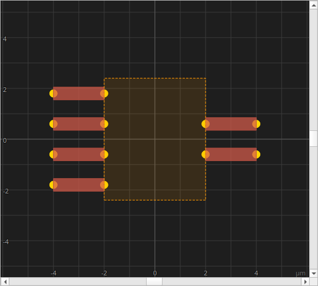
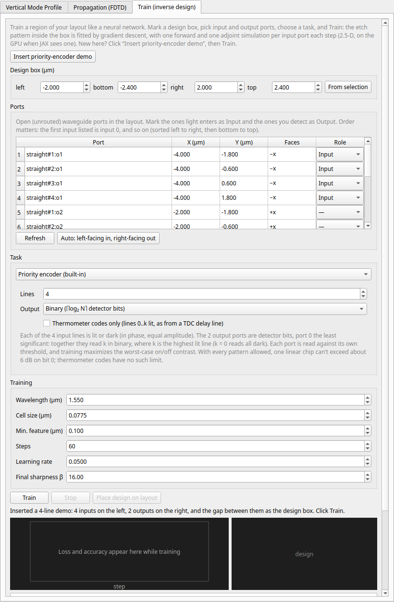
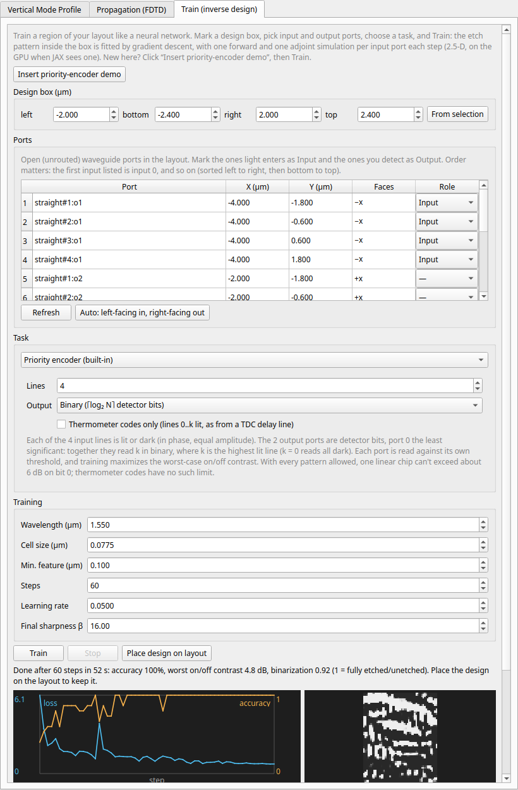
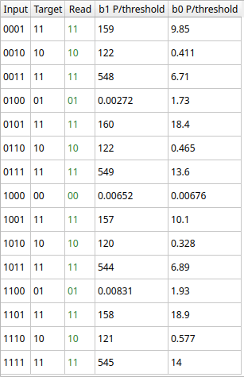
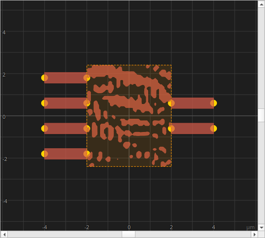

# Tutorial — Training a priority encoder

This walkthrough trains a small chip to be a **4-to-2 priority encoder**,
entirely in the GUI, in about a minute on a GPU. Along the way it covers the
**Train** tab, which works like fitting a neural network: a box on your layout
is the trainable part, its etch pattern plays the role of the network's
weights, and gradient descent fits it to a task.

## What the chip has to do

Four input waveguides, lines 0 to 3, are each **lit** or **dark**. The chip has
two output waveguides with a detector on each, bits **b1** and **b0**. For every
input pattern, the two bits must read out, in binary, the number of the
**highest lit line**:

| Lit lines | Highest | b1 b0 |
|---|---|---|
| 0 | 0 | 0 0 (both dark) |
| 1, or 0 and 1 | 1 | 0 1 |
| 2, or 2 with any lower | 2 | 1 0 |
| 3, with anything | 3 | 1 1 |

Each detector compares its power with a threshold: bright reads 1, dark reads 0.
There are 15 non-empty patterns of four lines, and the chip has to read all of
them right.

**Thermometer codes.** A tapped delay line, as in a time-to-digital converter,
lights its taps from the bottom up and never skips one: `1000`, `1100`, `1110`,
`1111`, like the column in a thermometer. Those four are a special case of the
priority encoder's patterns, and the **Thermometer codes only** option trains
on just them.

## How training works

The chip is linear in the light, so for a fixed etch it is exactly a 2 × 4
complex **transfer matrix** `T`: the amplitude reaching each output from each
input. Phidler measures `T` with one simulation per input port, and every input
pattern `x` then gives output amplitudes `T x` with no further simulation. A
detector reads power, `|T x|²`, and that squaring is the network's only
nonlinearity.

The readouts aren't calibrated to absolute power, so the loss can't ask for
"1 µW on a 1". It asks for **contrast**: at each output, the dimmest sample that
should read 1 must be brighter than the brightest sample that should read 0, by
a target margin. Training maximizes the worst case, and the threshold then sits
halfway between them (geometrically). The tab reports **accuracy** (patterns
with both bits right) and the **worst on/off contrast** in dB.

Each training step runs the 4 port simulations forward, then 4 adjoint
simulations that give the gradient of the loss for every cell of the box at
once, and takes an Adam step. **A step costs 8 simulations however many
patterns you train on.** Runs use the 2.5-D effective-index reduction (see
[A much bigger run](guide.md#a-much-bigger-run-25-d-effective-index)): a
chip-plane grid at full-height core / fully etched, which keeps a step to about
a second.

## 1. Open the Train tab

Open the simulation window with the **Simulate** button in the toolbar and switch
to the **Train (inverse design)** tab. Check the **Acceleration** row on the
**Propagation** tab: it should say **JAX on the GPU**. If it says CPU and you have
an NVIDIA GPU, click **Check JAX GPU…** to see why (see
[It says "JAX on the CPU"](faq.md#it-says-jax-on-the-cpu-but-i-have-a-gpu)).
Training on the CPU works, but takes several times longer.

## 2. Insert the demo

Under **Task**, leave **Lines** at 4 and **Output** at **Binary**, then click
**Insert priority-encoder demo**. Phidler places four input waveguides on the
left and two output waveguides on the right (b0 below, b1 above) with a 4 µm gap
between them. It marks the inputs and outputs in the **Ports** table and sets the
**design box** to the gap, drawn on the canvas as an orange dashed rectangle. The
demo is one undo step, so **Ctrl+Z** removes all of it.



The tab now holds everything training needs:



- **Design box**: the region whose etch is trained. Everything outside it stays
  exactly as drawn. Type coordinates, or select components and click **From
  selection**.
- **Ports**: every open (unrouted) waveguide port on the layout. **Input** ports
  are where light is launched, **Output** ports are where it's detected.
  Order matters: the first input listed is line 0 and the first output is b0,
  and the list runs left to right, then bottom to top. **Auto** marks every port
  facing left as an input and every port facing right as an output.
- **Task**: **Priority encoder (built-in)**, 4 lines. **Output: Binary** gives
  the 2 detector bits; **One-hot** instead gives 4 outputs, with the light going
  to the port numbered after the highest lit line.
- **Training**: the defaults suit this demo. **Min. feature** is roughly the
  smallest feature the etch may contain. **Steps** is how many optimizer steps to
  take. **Final sharpness β** controls how hard the design is pushed to a clean
  etched/unetched pattern by the end (it starts soft and doubles over the first
  three quarters of the run).

## 3. Train

Click **Train**. The status line reports the grid it built, then each step's
loss, accuracy and worst contrast. The plot shows the loss (blue) and the
accuracy (orange), and the panel beside it shows the etch pattern evolving
(light = core, dark = etched). **Stop** ends the run after the current step and
keeps the design so far.



On an RTX 4080 the 60 steps take **52 s** and reach **100 %** accuracy: every
one of the 15 patterns reads the right code. The spikes in the loss curve come
right after β doubles: sharpening the design changes it a little, and the next
steps recover. **Binarization 0.92** means the final pattern is close to
cleanly etched or unetched everywhere (1.0 would be fully binary).

The table under the plot shows every pattern. **Input** lists lines 0 to 3 left
to right, **Target** and **Read** are `b1 b0`, and the last two columns are each
detector's power relative to its threshold: above 1 reads 1, below reads 0.



Bit b1 is easy: it reads 1 at 120× its threshold or more and 0 at under
0.01×. Bit b0 is the hard one, and its worst case sets the **4.8 dB**
contrast: its dimmest 1 (`0100`, line 1 alone) is 1.73× the threshold and its
brightest 0 (`1110`) is 0.58×. That's close to a hard limit. One linear chip
followed by detectors cannot make b0 much better: it must read 1 for line 1
alone, but 0 for line 2 alone *and* for lines 1 and 2 together, and with in-phase
inputs the best compromise is 2:1 in amplitude, 4:1 in power, about **6 dB**.

Thermometer codes don't have that conflict. Tick **Thermometer codes only** and
train again (80 steps): accuracy is again 100 %, but the worst contrast is
about **24 dB** (bit 0) and 30 dB (bit 1), because a thermometer code never
has line 2 lit without line 1. For a TDC behind a delay line, that's the setting
to use.

## 4. Place the design

Click **Place design on layout**. The trained etch becomes a `trained_design`
instance filling the box: real polygons on the core layer, with holes where the
pattern is etched through. It's an ordinary component from then on. You can move
it, it's saved with the project (the polygons are stored in the instance, so the
project reopens anywhere), it's exported with **File → Export GDS**, and you can
run the **Propagation** tab on it to watch the light route. **Ctrl+Z** removes it.



## Your own tasks

The **Task** dropdown has four more options.

**Classify a dataset (CSV / NPZ).** Train on your own input/output examples,
with the light going to the output port numbered by the class. A CSV has a header
row and one sample per row: columns `in0`, `in1`, … are the complex input
amplitudes (`1`, `0`, `0.5+0.5j`, `-1j`) and `label` is the output port that
should light up. An NPZ holds arrays `X` (samples × inputs, complex) and `Y`
(integer labels).

```
in0,in1,label
1,1,0
1,-1,1
1,1j,0
```

**Detector bits from a dataset (CSV / NPZ).** Like the binary encoder, but with
your own truth table: columns `out0`, `out1`, … hold the 0 or 1 each output's
detector should read (or `Y`, samples × outputs, in an NPZ). Trained for
worst-case contrast, as above.

**Output power fractions (CSV / NPZ).** Instead of bits, give the share of
power each output should get: columns `out0`, `out1`, … (each row is normalized
to fractions). Useful for splitters with input-dependent ratios.

**Target transfer matrix.** Make the chip implement a fixed linear map, such as a
50:50 coupler, a swap, or a 4-point DFT (presets are provided), entered as one
row per output: row `m`, column `n` is the amplitude from input `n` to output
`m`. The score is the **fidelity** `|⟨T, T_target⟩|² / (|T|² |T_target|²)`, which
ignores the overall scale and global phase.

Because port readouts aren't calibrated to absolute power (light is launched by a
point source, as on the Propagation tab), every task is trained on *relative*
powers: ratios between samples or between outputs. A design that loses light
evenly scores the same as a lossless one, so check the transmission of the placed
design on the **Propagation** tab.

## From the console

The same pipeline is scriptable from the built-in console:

```python
from phidler import chip_train as ct

box, ins, outs = ct.demo_priority_encoder_layout(doc, n=4, center_um=(50, 0))  # 4 in, 2 out
model = ct.ChipModel(doc, ct.TrainConfig(box_um=box, inputs=ins, outputs=outs))
task = ct.priority_encoder_task(4, thermometer=True)  # binary is the default
result = ct.train_chip(model, task, ct.TrainOptions(steps=80))
print(result.metrics["accuracy"], result.metrics["contrast_db"])
ct.place_trained_design(doc, model, result.rho_phys)
```

## Limits

- Training uses the 2.5-D reduction, so the design is a single full-height etch
  layer, with no partial (rib) etch.
- Ports must face along x or y.
- Training needs real waveguides leading into the box: the ports' launch and
  readout planes sit 0.3 µm inside each port's waveguide.
- Inputs are coherent and in phase, as from one laser split into lines. Inputs
  with random relative phases (independent sources) would need a different model.
